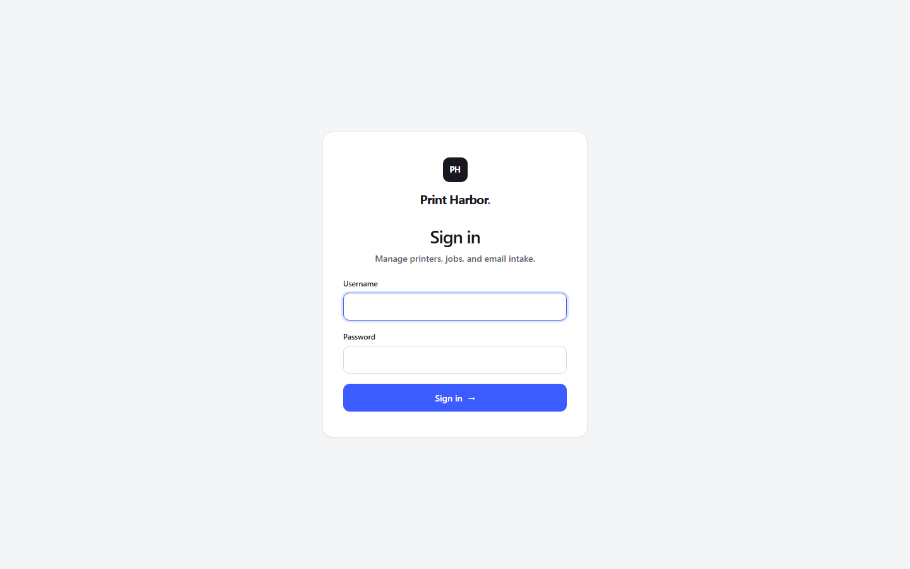
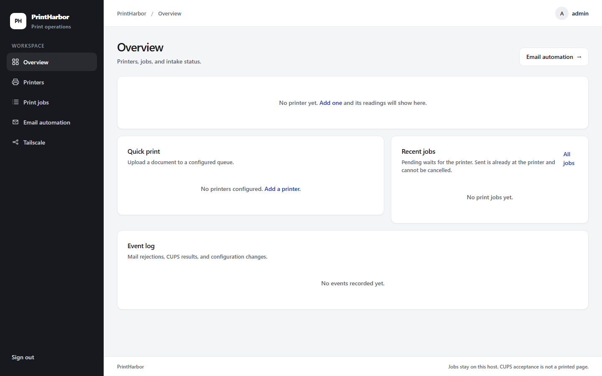
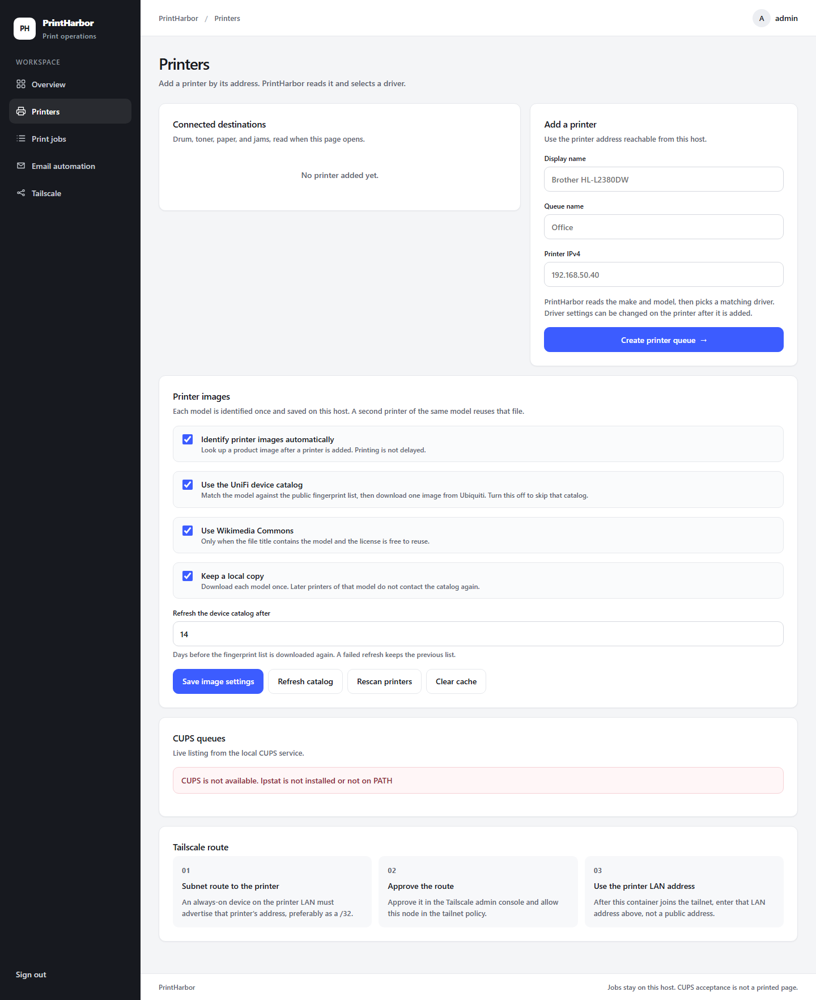
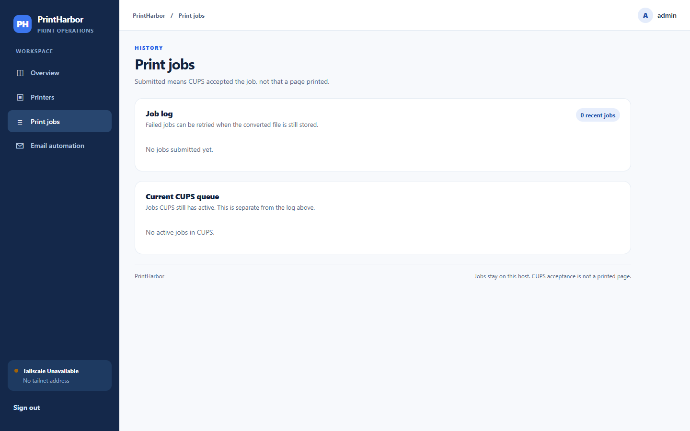
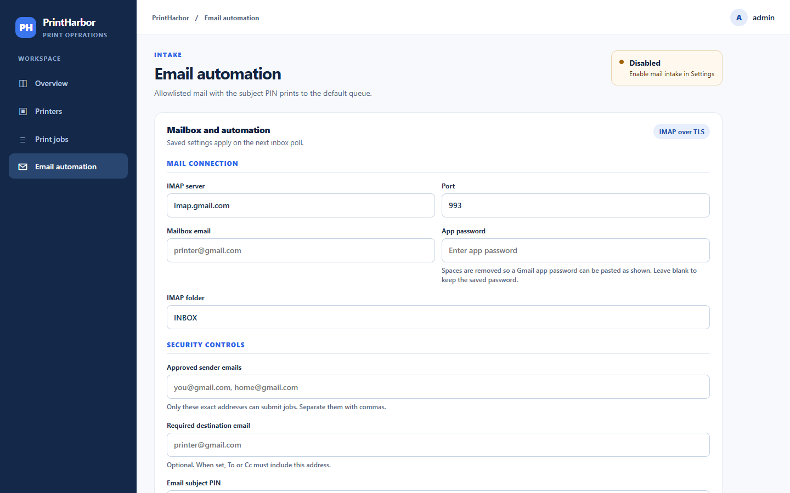

# PrintHarbor

PrintHarbor is a self-hosted print console for one administrator. It manages CUPS queues, accepts documents from the browser, converts them to PDF, and can print email attachments that pass a sender allowlist and a subject PIN.

## Who it is for

Use PrintHarbor on a host that can reach your printer. That host can be on the same network as the printer, or on another network when a Tailscale subnet router advertises the printer's address. The dashboard is for the person who runs that host.

## Capabilities

- One admin account, created on first launch from `ADMIN_USER` (default `admin`) and `ADMIN_PASSWORD`
- IPP queues at `ipp://address/ipp/print`, or raw port 9100 queues, with remove and CUPS queue listing
- Printer reachability over TCP port 631 for IPP, or port 9100 for raw
- Optional SNMP lifetime page count when `snmpget` is installed (a page counter, separate from toner level)
- Browser upload of PDF, PNG, JPEG, WEBP, TIFF, TXT, DOCX, XLSX, ODT, and ODS
- Conversion to PDF: images and plain text in the app, Office files through LibreOffice
- Page, file-size, and attachment limits
- Job history with retry for failed jobs and cancel for an active CUPS job id
- IMAP over TLS, with the mailbox password encrypted at rest
- Sender allowlist, mandatory subject PIN, and an optional check that To or Cc includes a chosen address
- Subject commands for long-edge duplex (`DUPLEX` or `2-SIDED`), short-edge duplex (`SHORT EDGE`), and `COPIES=` from 1 to 10
- Event log for rejections, CUPS results, and settings changes
- Tailscale join from the dashboard, when the container can open `/dev/net/tun`

Submitted means CUPS accepted the job. A sheet leaving the printer is a separate outcome.

## How it works

1. Sign in to the dashboard.
2. Add a printer by its IPv4 address. PrintHarbor asks the local CUPS service to create the queue.
3. A browser upload, or an email that passes the allowlist and PIN, is stored, converted to PDF, checked against the page limit, and handed to CUPS with `lp`.
4. The job log keeps the result. Failed jobs stay available for retry while the converted file is still on disk.

A mailbox subject looks like this:

```text
PRINT PIN:YOURPIN DUPLEX COPIES=2
```

Leave duplex words out of the subject to use the default sides setting. `SHORT EDGE` selects short-edge duplex.

## Screenshots

These are the dashboard on a fresh local session. No printer, mailbox, or tailnet was connected. Gray text in the forms is placeholder copy from the interface.











## Setup requirements

- Python 3.12
- CUPS, including `lp`, `lpadmin`, `lpstat`, `cancel`, `cupsaccept`, and `cupsenable`
- LibreOffice on `PATH` when you need DOCX, XLSX, ODT, or ODS conversion
- An IMAP mailbox and an app password. Gmail uses `imap.gmail.com` port 993
- `SESSION_SECRET`: a unique random value of at least 32 characters. Values shorter than that, and the placeholder in `.env.example`, are rejected
- `ADMIN_PASSWORD`: set before first launch, at least 12 characters, and different from the placeholder. The account is created when it does not already exist
- Optional Tailscale auth key (`TS_AUTHKEY`) when you use the included Compose file
- Optional `snmpget` and `SNMP_COMMUNITY` for the lifetime page counter

The Docker image installs CUPS, LibreOffice, and the related tools. `start.sh` starts `cupsd`, then Uvicorn on port 47831 inside the container.

## Setup

Copy the example environment file and create a session secret:

```bash
cp .env.example .env
python3 -c 'import secrets; print(secrets.token_urlsafe(48))'
```

Put that value in `SESSION_SECRET`. Set `ADMIN_PASSWORD` to your own password. Set `TS_AUTHKEY` as well when you use Docker Compose.

Compose publishes the dashboard on the host loopback interface:

```bash
docker compose up -d --build
```

On the Docker host, open `http://127.0.0.1:8765`. From another machine, use an SSH tunnel or access allowed by your tailnet policy.

To run the app without Compose, install the Python packages and start Uvicorn yourself. That host still needs CUPS for printing and LibreOffice for Office files:

```bash
python -m venv .venv
. .venv/bin/activate
pip install -r requirements.txt
export DATA_DIR=/var/lib/printharbor
export SESSION_SECRET="your-random-secret-at-least-32-characters"
export ADMIN_PASSWORD="your-long-admin-password"
uvicorn app.main:app --host 127.0.0.1 --port 8000
```

On Windows PowerShell, set `DATA_DIR`, `SESSION_SECRET`, and `ADMIN_PASSWORD` with `$env:` and use `.venv\Scripts\Activate.ps1`.

After the dashboard is up:

1. Open Printers and add the printer IPv4 address. Prefer IPP. If CUPS rejects the queue, the error is shown and the printer is not saved.
2. Send a single-page PDF with Quick print before enabling email.
3. Open Email automation. Enter the mailbox, app password, allowlisted senders, and default queue. A later save can leave the password blank to keep the saved one. Set a subject PIN of 6 to 32 letters or digits, or keep the PIN generated on first launch. That PIN is shown on the email page.
4. Enable automatic email printing and save.

Mailbox credentials are entered in the dashboard. They are stored encrypted with a key derived from `SESSION_SECRET`.

The Compose Tailscale service accepts advertised routes. A device on the printer LAN still has to advertise that printer's address, preferably as a `/32`, and the route has to be approved in the tailnet policy. Enter that LAN address in Printers.

## Operational notes

- Keep `.env` private. It holds the session secret, the initial admin password, and the Tailscale auth key.
- Rotate the subject PIN from Email automation if it is exposed.
- Uploaded documents remain in the data directory so failed jobs can be retried. This release has no automatic retention cleanup.
- The email poller reads up to 35 unread messages per cycle and marks handled messages seen, including rejected ones. It does not delete mail.
- There is one admin account. Quotas, per-user roles, DKIM, and DMARC checks are outside this release.

Screenshots in this repository were captured from the local dashboard with no printer, mailbox, or tailnet connected. CUPS, IMAP, and physical printers were not exercised for those images.

## Tests

```bash
python -m unittest discover -s tests -v
```

Route tests use FastAPI's `TestClient`, which needs the `httpx` package installed.

## License

MIT. See [LICENSE](LICENSE). Dependencies are covered by their own licenses.
